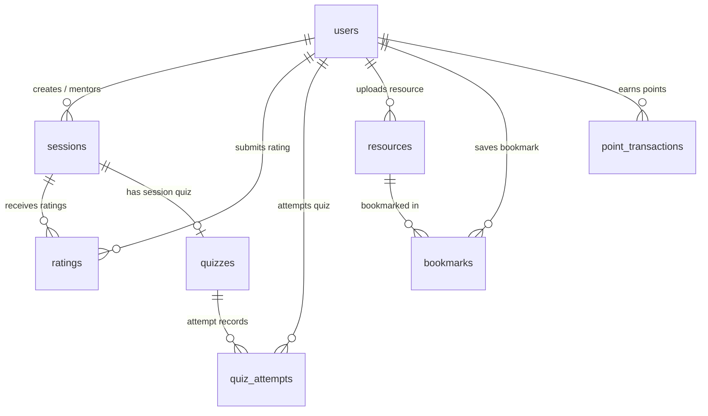

# PeerBridge — Database Setup & Architecture Guide

This document describes the database design, MongoDB connection configuration, collection schemas, indexes, and setup instructions for the **PeerBridge** platform.

---

## 1. Overview

PeerBridge uses **MongoDB** as its primary document database, connected through the **Mongoose** Object Data Modeling (ODM) library in Node.js.

- **Development Database**: Local MongoDB Community Server (`mongodb://127.0.0.1:27017/peerbridge`)
- **Production Database**: MongoDB Atlas (Free Tier M0 Replica Set)
- **Total Collections**: 8 collections



---

## 2. Collection Schemas & Data Dictionary

### 2.1 `users` Collection
Stores student and mentor profiles. Roles are automatically determined by the server based on the year of study.

| Field | Type | Required | Default | Description / Constraints |
| :--- | :--- | :--- | :--- | :--- |
| `_id` | ObjectId | Yes | Auto | Primary Key |
| `name` | String | Yes | — | Student's full name (trimmed) |
| `email` | String | Yes | — | Unique, lowercase, trimmed email |
| `password` | String | Yes | — | Bcrypt hashed password (`select: false`) |
| `role` | String | Yes | — | Enum: `['junior', 'senior']` (server-derived from `year`) |
| `college` | String | Yes | — | College or University name |
| `year` | Number | Yes | — | Year of study (1 to 4) |
| `bio` | String | No | `""` | User bio (max 500 chars) |
| `skills` | [String] | No | `[]` | Array of skill tags |
| `photo` / `photoUrl` | String | No | `""` | Profile photo URL |
| `socialLinks` | Object | No | `{}` | `{ github: "", linkedin: "", twitter: "" }` |
| `points` | Number | No | `0` | Running reward points total |
| `badge` | String | No | `"Newcomer"` | Current tier (`Newcomer`, `Learner`, `Achiever`, `Champion`) |
| `avgRating` | Number | No | `0` | Average star rating (for seniors) |
| `ratingCount` | Number | No | `0` | Total number of ratings received |
| `createdAt` | Date | No | Auto | Account creation timestamp |

**Indexes:**
- `{ email: 1 }` (Unique)
- `{ points: -1, createdAt: 1 }` (Student leaderboard query)
- `{ role: 1, avgRating: -1, ratingCount: -1 }` (Mentor leaderboard query)

---

### 2.2 `sessions` Collection
Stores peer-learning sessions created by seniors.

| Field | Type | Required | Default | Description / Constraints |
| :--- | :--- | :--- | :--- | :--- |
| `_id` | ObjectId | Yes | Auto | Primary Key |
| `title` | String | Yes | — | Session title |
| `description` | String | No | `""` | Session overview & objectives |
| `category` | String | Yes | `"Academic"` | Enum: `Academic`, `Career Preparation`, `Coding & Tech`, etc. |
| `subject` | String | Yes | — | Subject / Course (e.g., DBMS, DSA) |
| `topic` | String | No | `""` | Specific sub-topic |
| `difficulty` | String | Yes | `"Beginner"` | Enum: `Beginner`, `Intermediate`, `Advanced` |
| `startsAt` | Date | Yes | — | Session start time in UTC |
| `meetingPlatform`| String | No | `"Google Meet"`| Enum: `Google Meet`, `Zoom`, `Microsoft Teams`, `Other` |
| `meetingLink` | String | Yes | — | Valid http/https URL |
| `mentorId` | ObjectId | Yes | — | Ref: `User` (must be a senior) |
| `maxSeats` | Number | Yes | `30` | Max attendee limit (min: 1) |
| `registeredStudents` | [ObjectId] | No | `[]` | Refs: `User` (array of enrolled students) |
| `tags` | [String] | No | `[]` | Tags for discoverability |
| `status` | String | Yes | `"upcoming"` | Enum: `upcoming`, `completed`, `cancelled` |

**Indexes:**
- `{ startsAt: 1 }`
- `{ subject: 1, category: 1, difficulty: 1 }`
- `{ mentorId: 1 }`

---

### 2.3 `quizzes` Collection
Stores quizzes linked to specific sessions (one quiz per session).

| Field | Type | Required | Default | Description / Constraints |
| :--- | :--- | :--- | :--- | :--- |
| `_id` | ObjectId | Yes | Auto | Primary Key |
| `sessionId` | ObjectId | Yes | — | Ref: `Session` (Unique: 1 quiz per session) |
| `title` | String | Yes | — | Quiz title |
| `timeLimitMin`| Number | Yes | `15` | Duration in minutes (min: 1) |
| `questions` | [Object] | Yes | — | Array of question objects |
| `questions[].question` | String | Yes | — | Prompt text |
| `questions[].options` | [String] | Yes | — | 2 to 6 multiple choice options |
| `questions[].correctIndex` | Number | Yes | — | 0-based index of correct option |
| `questions[].marks` | Number | Yes | `1` | Mark value |
| `questions[].explanation` | String | No | `""` | Explanation revealed post-submission |
| `totalMarks` | Number | No | `0` | Sum of marks (auto-calculated pre-save) |
| `isPublished`| Boolean | Yes | `false` | Student visibility toggle |
| `createdBy` | ObjectId | Yes | — | Ref: `User` (Mentor owner) |

**Indexes:**
- `{ sessionId: 1 }` (Unique)

---

### 2.4 `quiz_attempts` Collection
Records student quiz attempts, countdown timers, autosaved answers, and scores.

| Field | Type | Required | Default | Description / Constraints |
| :--- | :--- | :--- | :--- | :--- |
| `_id` | ObjectId | Yes | Auto | Primary Key |
| `quizId` | ObjectId | Yes | — | Ref: `Quiz` |
| `sessionId` | ObjectId | Yes | — | Ref: `Session` |
| `studentId` | ObjectId | Yes | — | Ref: `User` |
| `startedAt` | Date | Yes | `Date.now` | Server timestamp when student started |
| `deadlineAt` | Date | Yes | — | Server deadline (`startedAt + timeLimit`) |
| `answers` | [Object] | No | `[]` | Array of `{ questionIndex, selectedIndex }` |
| `status` | String | Yes | `"IN_PROGRESS"`| Enum: `IN_PROGRESS`, `SUBMITTED`, `AUTO_SUBMITTED` |
| `score` | Number | No | `0` | Marks scored |
| `totalMarks` | Number | No | `0` | Max possible marks |
| `percent` | Number | No | `0` | Percentage score (0 - 100) |
| `pointsAwarded`| Number | No | `0` | Gamification points earned |
| `submittedAt`| Date | No | — | Submission timestamp |

**Indexes:**
- `{ quizId: 1, studentId: 1 }` (Compound Unique: 1 attempt per student)

---

### 2.5 `ratings` Collection
Stores 5-star session feedback provided by registered juniors.

| Field | Type | Required | Constraints |
| :--- | :--- | :--- | :--- |
| `_id` | ObjectId | Yes | Primary Key |
| `sessionId` | ObjectId | Yes | Ref: `Session` |
| `mentorId` | ObjectId | Yes | Ref: `User` |
| `studentId` | ObjectId | Yes | Ref: `User` |
| `subjectKnowledge` | Number | Yes | Min: 1, Max: 5 |
| `explanationQuality` | Number | Yes | Min: 1, Max: 5 |
| `communication` | Number | Yes | Min: 1, Max: 5 |
| `usefulness` | Number | Yes | Min: 1, Max: 5 |
| `overall` / `overallRating` | Number | Yes | Min: 1, Max: 5 |
| `feedback` | String | No | Optional text (max 500 chars) |

**Indexes:**
- `{ sessionId: 1, studentId: 1 }` (Compound Unique: 1 rating per session per student)
- `{ mentorId: 1 }` (Aggregation index)

---

### 2.6 `resources` Collection
Central library for study materials, cheat sheets, PDFs, and repository links.

| Field | Type | Required | Default | Description / Constraints |
| :--- | :--- | :--- | :--- | :--- |
| `_id` | ObjectId | Yes | Auto | Primary Key |
| `title` | String | Yes | — | Resource title |
| `description`| String | No | `""` | Description |
| `subject` | String | Yes | — | Academic subject |
| `type` | String | Yes | `"OTHER"` | Enum: `PDF`, `NOTES`, `VIDEO`, `GITHUB`, `OTHER` |
| `link` | String | Yes | — | Valid URL (validated regex) |
| `uploadedBy` | ObjectId | Yes | — | Ref: `User` |
| `upvotedBy` | [ObjectId] | No | `[]` | Array of student user IDs who upvoted |
| `upvoteCount`| Number | No | `0` | Total upvotes |

**Indexes:**
- `{ title: "text", description: "text", subject: "text" }` (Full text search)
- `{ subject: 1, type: 1 }`

---

### 2.7 `bookmarks` Collection
Maintains user saved/bookmarked resources.

| Field | Type | Required | Description |
| :--- | :--- | :--- | :--- |
| `_id` | ObjectId | Yes | Primary Key |
| `userId` | ObjectId | Yes | Ref: `User` |
| `resourceId` | ObjectId | Yes | Ref: `Resource` |
| `createdAt` | Date | No | Timestamp |

**Indexes:**
- `{ userId: 1, resourceId: 1 }` (Compound Unique)

---

### 2.8 `point_transactions` Collection
Immutable audit log tracking every point modification to guarantee no double awards.

| Field | Type | Required | Description |
| :--- | :--- | :--- | :--- |
| `_id` | ObjectId | Yes | Primary Key |
| `userId` | ObjectId | Yes | Ref: `User` |
| `action` | String | Yes | `SESSION_ATTENDED`, `QUIZ_COMPLETE`, `RATING_GIVEN`, `RESOURCE_SHARED` |
| `points` | Number | Yes | Point amount awarded |
| `refType` | String | Yes | Ref model: `Session`, `Quiz`, `Resource`, `System` |
| `refId` | ObjectId | Yes | ID of referenced entity |
| `createdAt` | Date | No | Timestamp |

**Indexes:**
- `{ userId: 1, action: 1, refId: 1 }` (Compound Unique: prevents duplicate award calls)

---

## 3. Database Setup Instructions

### 3.1 Local MongoDB Setup
1. **Install MongoDB Community Server**:
   Download and install from the official MongoDB website (or via Windows MSI).
2. **Start the MongoDB Service**:
   ```powershell
   net start MongoDB
   ```
3. **Verify via MongoDB Compass or Shell**:
   Connect to `mongodb://127.0.0.1:27017` and verify the `peerbridge` database is created automatically upon first insertion.

### 3.2 MongoDB Atlas (Cloud Setup)
1. Sign in to [MongoDB Atlas](https://www.mongodb.com/cloud/atlas).
2. Create a Free Shared Cluster (M0).
3. Under **Database Access**, create a user with `Read and write to any database` privileges.
4. Under **Network Access**, add IP `0.0.0.0/0` (Allow Access from Anywhere) for cloud deployment (or your static IP for dev).
5. Obtain the connection URI:
   ```env
   MONGO_URI=mongodb+srv://<username>:<password>@cluster0.mongodb.net/peerbridge?retryWrites=true&w=majority
   ```

### 3.3 Backend Configuration (`backend/.env`)
Create or verify `backend/.env`:
```env
PORT=5000
MONGO_URI=mongodb://127.0.0.1:27017/peerbridge
JWT_SECRET=peerbridge_super_secret_jwt_key_2026
JWT_EXPIRES_IN=24h
```

### 3.4 Verification Command
From the backend directory, run:
```powershell
cd backend
npm run dev
```
Expected output:
```
PeerBridge Server running on port 5000
MongoDB connected
```
