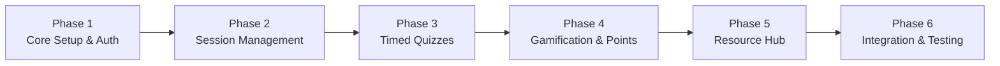

# PeerBridge — Project Implementation Plan

This document details the step-by-step implementation roadmap, sprint milestones, requirements traceability, and testing plan executed to build the **PeerBridge** platform.

---

## 1. Project Implementation Phases

---

### Phase 1: Core Setup & Authentication (Sprint 1)
**Objective:** Establish MERN architecture, secure authentication, and profile foundation.
- **Backend Tasks**:
  - Initialize Express app, CORS, JSON parser, and MongoDB Atlas connection.
  - Implement `User` model with schema constraints, bcrypt hashing, and password hiding.
  - Implement server-side role deduction: `year <= 2` &rarr; `junior`, `year >= 3` &rarr; `senior`.
  - Build `authController` (`register`, `login`, `getMe`, `updateProfile`).
  - Create JWT auth middleware (`protect`) and role authorization middleware (`authorize`).
- **Frontend Tasks**:
  - Scaffold Vite React application with React Router.
  - Configure `axios.js` client with base URL and JWT request interceptor.
  - Create `AuthContext.jsx` for persistent login state across page refreshes.
  - Build `Login.jsx`, `Signup.jsx` (with role preview), and `Profile.jsx`.

---

### Phase 2: Session Management & Atomic Seat Booking (Sprint 2)
**Objective:** Enable mentors to schedule sessions and students to discover and register without race conditions.
- **Backend Tasks**:
  - Implement `Session` model with UTC `startsAt`, `maxSeats`, `registeredStudents`, and meeting URLs.
  - Implement `sessionController` CRUD: `createSession`, `getSessions`, `getSessionById`, `updateSession`, `deleteSession`.
  - Engineer atomic seat reservation using `findOneAndUpdate` with `$expr` seat comparison.
  - Enforce access control: mentors can only edit/delete their own sessions; students cannot register for their own session or register twice.
- **Frontend Tasks**:
  - Build `Sessions.jsx` with real-time keyword search, category, difficulty, and timeline filters.
  - Create `CreateSession.jsx` form with date/time pickers and URL validation.
  - Build `MySessions.jsx` with tabbed views for "Enrolled Sessions" and "Created Sessions".
  - Build `RegisteredStudentsModal.jsx` for senior mentors to view attendee rosters.

---

### Phase 3: Timed Quiz Engine & Server Scoring (Sprint 3)
**Objective:** Deliver an assessment module linked to sessions with server-managed timers and secure grading.
- **Backend Tasks**:
  - Implement `Quiz` and `QuizAttempt` models with unique compound indexes.
  - Implement quiz creation and editing endpoints for session hosts.
  - Build `startQuizAttempt`: initializes server `deadlineAt` and strips `correctIndex` & `explanation` from questions payload (`QUIZ-N1`).
  - Build `autosaveAnswer` (`PATCH /attempts/:id/answer`): saves student choices and checks expiry.
  - Build `submitQuizAttempt` (`POST /attempts/:id/submit`): grades answers on server, computes marks, percentage, and triggers `PointsService`.
- **Frontend Tasks**:
  - Build `QuizBuilderModal.jsx` for mentors to author multiple-choice questions, mark allocations, and explanations.
  - Build `QuizAttemptModal.jsx` featuring real-time question navigation, autosave indicators, and server countdown timer (`QuizTimer.jsx`).
  - Build `QuizResultModal.jsx` displaying score breakdown, percentage, earned points, and mentor explanations.
  - Create dedicated `Quizzes.jsx` hub for pending post-meeting quizzes and completed scorecards.

---

### Phase 4: Gamification, Points Service & Dual Leaderboards (Sprint 4)
**Objective:** Motivate student participation through audited points, badges, and campus rankings.
- **Backend Tasks**:
  - Implement `PointTransaction` model with unique constraint `(userId + action + refId)` to guarantee no double awarding (`LEAD-N1`).
  - Create `PointsService.award()` and centralized `pointsConfig.js`.
  - Implement Rating module: `Rating` model, 5-star metric collection, post-session timing check (`startsAt <= now`), and mentor average score aggregation (`avgRating`, `ratingCount`).
  - Implement Leaderboard APIs: `GET /leaderboard/students`, `GET /leaderboard/mentors` (`ratingCount >= 3`), `GET /leaderboard/me`.
- **Frontend Tasks**:
  - Build `Leaderboard.jsx` with tabs for Student Points Rankings and Top Mentors by Star Rating.
  - Highlight logged-in user position banner on leaderboard.
  - Integrate user badge chips (*Newcomer*, *Learner*, *Achiever*, *Champion*) and points pills into `Navbar.jsx` and `Dashboard.jsx`.
  - Build `RatingModal.jsx` for submitting 5-star evaluations.

---

### Phase 5: Resource Sharing & Bookmarks Library (Sprint 5)
**Objective:** Establish a centralized, searchable study material repository.
- **Backend Tasks**:
  - Implement `Resource` model with full text index on `title`, `description`, `subject`.
  - Implement `Bookmark` model with unique index on `(userId + resourceId)`.
  - Build resource endpoints: search & filter, upload resource link (+3 points award with 3 shares/day cap), toggle upvote, and toggle bookmark.
- **Frontend Tasks**:
  - Build `Resources.jsx` with search bar, subject filter, and material type pills (PDF, Notes, Video, GitHub, Other).
  - Implement `ShareResourceModal.jsx` with URL validation.
  - Create "My Saved Bookmarks" tab.

---

### Phase 6: System Integration, UI Polish & Acceptance Testing (Sprint 6)
**Objective:** Unify modules, enhance user experience, and validate all test cases.
- **Tasks**:
  - Build centralized `Dashboard.jsx` featuring role-based greetings, stats widgets, badge progress bar, and upcoming sessions.
  - Resolve Mongoose deprecation warnings (`returnDocument: "after"`).
  - Verify complete end-to-end user journeys (registration &rarr; session booking &rarr; quiz attempt &rarr; mentor rating &rarr; leaderboard rank).
  - Run build verification (`npm run build`, `node -c`).

---

## 2. Test Execution Matrix (HLD/LLD Section 3.9)

| ID | Test Scenario | Steps & Action | Expected Result | Status |
| :--- | :--- | :--- | :--- | :--- |
| **TC1** | Register with year 2 | Register user with `year: 2` | Server assigns role `junior` | **Pass** |
| **TC2** | Register with year 4 & role=junior | Register with `year: 4, role: 'junior'` | Server assigns role `senior` (body role ignored) | **Pass** |
| **TC3** | Register existing email | Register with already registered email | Returns `409 Conflict` | **Pass** |
| **TC4** | Login with wrong password | Submit incorrect password | Returns generic `401: Invalid email or password` | **Pass** |
| **TC5** | Junior opens create session | Junior makes POST `/sessions` | Returns `403 Forbidden` | **Pass** |
| **TC6** | Mentor edits another's session | Senior tries PUT on session not owned | Returns `403 Forbidden` | **Pass** |
| **TC7** | Register for session twice | Student submits duplicate registration | Returns `409 Conflict` (Already registered) | **Pass** |
| **TC8** | Two students take last seat | Concurrent registration requests | One succeeds (`200`); second receives `409 Full` | **Pass** |
| **TC9** | Mentor registers for own session | Senior registers for own session | Returns `400 Bad Request` | **Pass** |
| **TC10**| Unregistered student starts quiz | Student starts quiz without session registration | Returns `403 Forbidden` | **Pass** |
| **TC11**| Check quiz start response payload | Inspect questions returned on start | No `correctIndex` or `explanation` present | **Pass** |
| **TC12**| Page refresh during quiz | Refresh browser tab while quiz timer runs | Same `deadlineAt` returned; timer continues | **Pass** |
| **TC13**| Timer reaches 0 | Allow countdown to expire | Auto-submits as `AUTO_SUBMITTED` & grades | **Pass** |
| **TC14**| Submit same quiz again | Re-submit already submitted attempt | Returns existing result; points not added twice | **Pass** |
| **TC15**| Rate session twice | Submit second rating for same session | Returns `409 Conflict` | **Pass** |
| **TC16**| Rate before session start | Submit rating before `startsAt` | Returns `400 Bad Request` (Rating not open) | **Pass** |
| **TC17**| Add valid rating | Junior rates mentor after session | Mentor `avgRating` & `ratingCount` recalculate | **Pass** |
| **TC18**| Student opens leaderboard | User views leaderboard position | User row highlighted with correct rank | **Pass** |
| **TC19**| Mentor with 2 ratings | Senior has 2 ratings | Does not appear on mentor leaderboard (< 3 ratings) | **Pass** |
| **TC20**| Share resource with external link | Share valid Google Drive / GitHub link | Link opens safely in new tab; no server crash | **Pass** |
| **TC21**| Upvote same resource twice | Click upvote button twice | First click upvotes; second removes upvote (toggle) | **Pass** |
