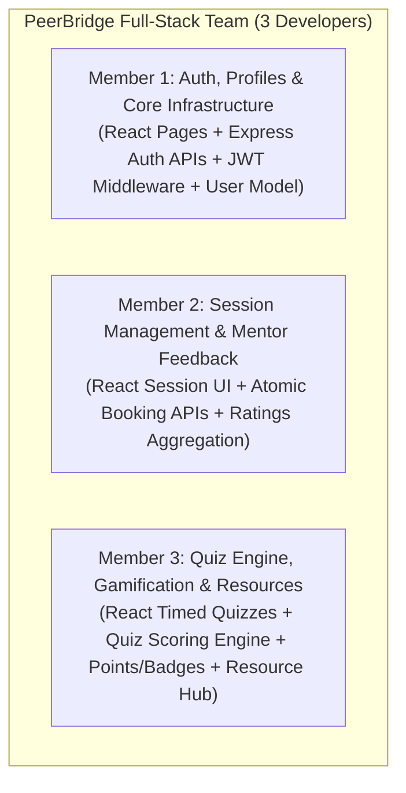

# PeerBridge — Developer Contract & Team Standards

This agreement establishes the development standards, architectural responsibilities, and team workflow for the **PeerBridge** project team.

---

## 1. Team Overview & Full-Stack Collaboration

The development team consists of **3 members**, each operating as a **Full-Stack Engineer** responsible for both the frontend React interface and the backend Express/MongoDB services within their assigned domain:

---

## 2. Module Responsibilities Matrix

| Team Member | Frontend Scope | Backend Scope | Key Deliverables |
| :--- | :--- | :--- | :--- |
| **Member 1** | • `Login.jsx` & `Signup.jsx` with role preview • `Profile.jsx` (bio, skills tags, social links, points log) • `AuthContext.jsx` (session persistence) • `Navbar.jsx` with responsive tabs & badges • `axios.js` client with JWT interceptor | • `models/User.js` (schemas, bcrypt pre-save, methods) • `controllers/authController.js` • `middleware/auth.js` (`protect`, `authorize`) • `routes/authRoutes.js` & `routes/userRoutes.js` • Server setup & environment config | • JWT token generation (24h) • Server-side role calculation (Year 1–2 &rarr; Junior, 3–4 &rarr; Senior) • Safe authentication errors (`AUTH-N3`) • User profile retrieval & update |
| **Member 2** | • `Sessions.jsx` (Search, Category/Difficulty filter, seat counters) • `CreateSession.jsx` (DateTime, platform, meeting link) • `MySessions.jsx` (Created vs Enrolled tabs) • `RegisteredStudentsModal.jsx` (Attendee roster) • `RatingModal.jsx` (5-star ratings & feedback) | • `models/Session.js` (startsAt UTC, maxSeats, seatsLeft virtual) • `models/Rating.js` (5 rating metrics, unique index) • `controllers/sessionController.js` (CRUD, atomic registration) • `controllers/ratingController.js` (aggregate ratings) • `routes/sessionRoutes.js` & `routes/ratingRoutes.js` | • Atomic MongoDB seat reservation (`findOneAndUpdate` with `$expr`) • Prevention of double-booking, overbooking, and self-registration • Rating activation post-session (`startsAt <= now`) • Mentor average score re-computation |
| **Member 3** | • `Quizzes.jsx` (Dedicated Quizzes Hub) • `QuizBuilderModal.jsx` (Multiple-choice builder & explanations) • `QuizAttemptModal.jsx` & `QuizTimer.jsx` (Live timer & autosave) • `QuizResultModal.jsx` (Scorecard, explanations, points) • `Leaderboard.jsx` (Students & Mentors tabs) • `Resources.jsx` & `ShareResourceModal.jsx` | • `models/Quiz.js`, `models/QuizAttempt.js` • `models/PointTransaction.js` • `models/Resource.js`, `models/Bookmark.js` • `services/PointsService.js` • `config/pointsConfig.js` • `controllers/quizController.js` • `controllers/leaderboardController.js` • `controllers/resourceController.js` | • Server-side quiz timing & autosave (`PATCH /attempts/:id/answer`) • Server scoring with answer obfuscation until submit • Points audit logging with unique constraint to block double awards • Student & Mentor leaderboards (`ratingCount >= 3`) • Resource sharing with upvote & bookmark toggles |

---

## 3. Shared Engineering Standards

### 3.1 REST API & HTTP Status Codes
All controllers must adhere to standardized HTTP status codes:
- **`200 OK`**: Successful GET / PUT / PATCH queries.
- **`201 Created`**: Successful POST resource creation (Session, Quiz, Rating, Account).
- **`400 Bad Request`**: Client validation failures (missing required fields, invalid date/URL).
- **`401 Unauthorized`**: Missing or expired JWT token.
- **`403 Forbidden`**: Role restriction violated (e.g., Junior creating session, non-owner modifying quiz).
- **`404 Not Found`**: Resource does not exist.
- **`409 Conflict`**: Unique constraint violation (duplicate email, already registered, session full, quiz already submitted).
- **`500 Internal Server Error`**: Unexpected database or runtime failure.

### 3.2 Security Standards
1. **Passwords**: Must never be stored or logged in plain text. Hashed using `bcryptjs` with salt rounds = 10. `select: false` on Mongoose schema.
2. **Tokens**: Signed using `jsonwebtoken` with server secret. Attached via `Authorization: Bearer <token>`.
3. **Quiz Answers**: `correctIndex` and `explanation` are strictly withheld from quiz start payloads (`QUIZ-N1`). Sent only after graded submission.
4. **Environment Variables**: Sensitive credentials (port, database URI, JWT secret) must be stored in `.env` and excluded via `.gitignore`.

### 3.3 Database Integrity & Concurrency
1. **No Application-Level Race Conditions**: Concurrency-sensitive operations (seat booking, points awarding) must use atomic database operations (`findOneAndUpdate`, `$addToSet`, unique compound indexes).
2. **Double Award Protection**: All point grants must pass through `PointsService.award()`, backed by `point_transactions` unique index `(userId + action + refId)`.

### 3.4 Frontend UI Consistency
1. **Design System**: Use standard CSS variables defined in `frontend/src/index.css` for palette (`--primary: #4f46e5`, `--secondary: #0ea5e9`, `--accent: #f59e0b`, `--success: #10b981`, `--danger: #ef4444`).
2. **Responsiveness**: All pages must render cleanly on mobile (375px), tablet (768px), and desktop (1200px).
3. **Empty & Loading States**: Every async query must display a clear loading indicator and a helpful empty state when no records match.

---

## 4. Git Workflow & Merging Rules

1. **Branching Model**:
   - `main`: Production-ready, stable codebase.
   - `member-1`, `member-2`, `member-3`: Individual feature branches for ongoing development.
2. **Commit Conventions**:
   - Format: `<type>: <clear description of change>` (e.g., `feat: implement atomic seat booking`, `fix: remove deprecated mongoose new option`).
3. **Pre-Push Validation**:
   - Every contributor must run:
     1. Backend syntax check: `node -c server.js`
     2. Frontend compilation check: `npm run build`
   - Zero compilation or lint errors are tolerated prior to pushing to `main`.

---

## 5. Team Commitment Sign-Off

By committing to this repository, each team member affirms:
- Active ownership of their respective full-stack modules.
- Adherence to shared API conventions, security protocols, and Git workflows.
- Active participation in integration testing, bug triage, and project delivery.
