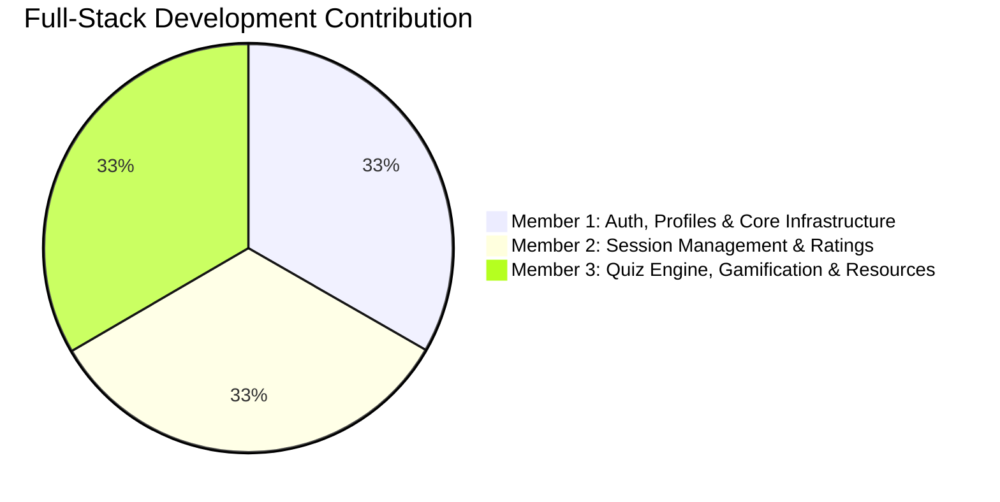

# PeerBridge — Team Work Split & Module Ownership

This document details the division of responsibilities and module ownership among the **3 team members**, where **all three members worked across both Frontend and Backend** to deliver the complete PeerBridge application.

---

## 1. Summary of Team Distribution

| Member | Domain & Modules | Frontend Contribution | Backend Contribution |
| :--- | :--- | :--- | :--- |
| **Member 1** | **Authentication, Profiles & Infrastructure** | React Auth Pages, Context State, Axios Interceptor, Navbar & Layout | User Schema, Bcrypt Hashing, JWT Auth Middleware, Profile APIs, Server Config |
| **Member 2** | **Session Management & Mentor Feedback** | Sessions Explorer, Create Session, My Sessions, Attendees Modal, Rating Modal | Session Model, Atomic Booking Controller, Rating Model, Mentor Aggregations |
| **Member 3** | **Quiz Assessment, Gamification & Resources** | Quizzes Hub, Quiz Builder, Live Timer & Autosave Modal, Leaderboards, Resource Hub | Quiz Models, Server-Side Grading Engine, Points Service, Leaderboard APIs, Resource APIs |

---

## 2. Detailed Breakdown by Team Member

### 👤 Member 1: Authentication, Profiles & Application Architecture
**Scope:** Full-Stack development of user onboarding, session persistence, role assignment, and core application layout.

#### Backend Responsibilities:
1. **User Schema & Data Modeling (`models/User.js`)**:
   - Defined user entity: name, email, password, role, college, year, bio, skills, photo, social links.
   - Enforced server-derived role logic (`AUTH-F3`): Year 1–2 &rarr; `junior`, Year 3–4 &rarr; `senior`.
   - Built Mongoose pre-save hook for `bcryptjs` password hashing and password comparison method.
2. **Authentication Controller (`controllers/authController.js`)**:
   - `signup`: Secure user registration with unique email validation and server role enforcement.
   - `login`: Credential validation with uniform safe error responses (`AUTH-N3`) and JWT signing.
   - `getMe`: Current user profile retriever including student rank and badge progress.
   - `updateProfile`: Updating bio, skills tag array, and social profiles.
   - `getUserById`: Public user profile endpoint.
3. **Security Middleware & Routing (`middleware/auth.js`, `routes/authRoutes.js`, `routes/userRoutes.js`)**:
   - `protect`: JWT token verification and user attachment to request.
   - `authorize`: Role-based route guard for junior/senior endpoints.
4. **Server & Error Infrastructure (`server.js`, `middleware/errorHandler.js`)**:
   - Server entry point, CORS configuration, centralized Mongoose error mapping.

#### Frontend Responsibilities:
1. **Authentication Screens (`pages/Login.jsx`, `pages/Signup.jsx`)**:
   - Modern sign-in and sign-up interfaces with real-time role preview based on selected year of study.
2. **Profile & Account Management (`pages/Profile.jsx`)**:
   - User summary card, bio editor, skills tag manager, social profile inputs, and point transaction audit log table.
3. **Client-Side State & HTTP Client (`context/AuthContext.jsx`, `api/axios.js`)**:
   - Centralized auth context with automatic session restoration via `GET /auth/me` on browser reload.
   - Axios request interceptor for JWT header injection and response interceptor for 401 redirect handling.
4. **Navigation & Global Layout (`components/Navbar.jsx`, `components/ProtectedRoute.jsx`)**:
   - Responsive dark glassmorphism navbar displaying user badge chip, reward points pill, active tab indicator, and logout.

---

### 👤 Member 2: Session Management & Mentorship Feedback
**Scope:** Full-Stack development of peer-learning sessions, race-condition-free seat booking, and 5-star mentor reviews.

#### Backend Responsibilities:
1. **Session Schema (`models/Session.js`)**:
   - Defined session entity: title, subject, category, difficulty, UTC `startsAt`, meeting platform, meeting link, `maxSeats`, `registeredStudents`, tags, and virtual `seatsLeft`.
2. **Atomic Session Controller (`controllers/sessionController.js`)**:
   - `createSession`: Senior-restricted session creation with date validation and http/https regex check.
   - `getSessions`: Comprehensive querying with keyword search and category/difficulty/status filters.
   - `registerForSession`: **Atomic MongoDB reservation** using `findOneAndUpdate` with `$expr` comparison to prevent double-booking, overbooking, and self-registration (`SESS-N1`, `D4`).
   - `getMySessions`: Distinguishes between enrolled sessions and mentor-created sessions.
   - `getRegisteredStudents`: Host-restricted attendee roster lookup.
   - `updateSession` / `deleteSession`: Host-restricted modification and deletion.
3. **Rating & Feedback Backend (`models/Rating.js`, `controllers/ratingController.js`, `routes/ratingRoutes.js`)**:
   - Rating schema capturing 5 distinct metrics (1 to 5 stars) and optional feedback text.
   - Enforced compound unique index `(sessionId + studentId)` to prevent duplicate ratings.
   - Enforced schedule check: rating opens only after session start time (`startsAt <= now`).
   - Aggregated mentor average score (`avgRating`) and review count (`ratingCount`) via MongoDB `$avg`.

#### Frontend Responsibilities:
1. **Sessions Explorer (`pages/Sessions.jsx`)**:
   - Search bar and multi-faceted dropdown filters (category, difficulty, timeline).
   - Session cards displaying mentor info, star ratings, local IST time format, and visual seat availability progress bar.
   - Instant "Register Seat" button with immediate feedback alert.
2. **Session Creation Interface (`pages/CreateSession.jsx`)**:
   - Comprehensive form for scheduling sessions with date/time pickers, platform selectors, seat limits, and link validation.
3. **Host Management Dashboard (`pages/MySessions.jsx`)**:
   - Tabbed view for "Created Sessions" (senior mentors) and "Enrolled Sessions" (junior students).
4. **Attendee Roster Modal (`components/RegisteredStudentsModal.jsx`)**:
   - Modal for mentors to view registered students, college, year, badge tier, and points.
5. **Interactive Rating Modal (`components/RatingModal.jsx`)**:
   - 5-star rating inputs for Subject Knowledge, Explanation Quality, Communication, Usefulness, and Overall Rating.

---

### 👤 Member 3: Quiz Assessment Engine, Gamification & Resource Hub
**Scope:** Full-Stack development of session quizzes, server-side grading, points and badge progression, campus leaderboards, and the study resource library.

#### Backend Responsibilities:
1. **Quiz Schemas (`models/Quiz.js`, `models/QuizAttempt.js`)**:
   - Multiple-choice quiz schema with time limits, marks, question options, and explanations.
   - `QuizAttempt` schema tracking server `startedAt`, `deadlineAt`, autosaved answers, and grading states (`IN_PROGRESS`, `SUBMITTED`, `AUTO_SUBMITTED`).
2. **Quiz Assessment Controller (`controllers/quizController.js`, `routes/quizRoutes.js`, `routes/attemptRoutes.js`)**:
   - `createQuiz` & `updateQuiz`: Senior quiz authoring and publish toggles.
   - `startQuizAttempt`: Initiates timed attempt, sanitizes questions by withholding `correctIndex` & `explanation` (`QUIZ-N1`), and awards session attendance points.
   - `autosaveAnswer`: Updates student choices and auto-closes attempts if deadline + 5s has passed.
   - `submitQuizAttempt`: Server-side grading, score and percentage computation, points calculation, and review generation.
   - `getQuizResultsForMentor`: Attendee score and submission log for mentors.
3. **Gamification & Points Engine (`services/PointsService.js`, `models/PointTransaction.js`, `config/pointsConfig.js`)**:
   - Atomic point awards with duplicate prevention backed by compound unique index `(userId + action + refId)`.
   - Automatic badge tier promotion: *Newcomer*, *Learner*, *Achiever*, *Champion*.
4. **Leaderboard Controller (`controllers/leaderboardController.js`, `routes/leaderboardRoutes.js`)**:
   - Student Leaderboard sorted by points and creation date.
   - Mentor Leaderboard filtered for seniors with at least 3 ratings (`ratingCount >= 3`).
   - Own rank calculation (`GET /leaderboard/me`).
5. **Resource Library Backend (`models/Resource.js`, `models/Bookmark.js`, `controllers/resourceController.js`, `routes/resourceRoutes.js`)**:
   - Full text search on title, description, and subject.
   - Resource sharing with daily rewarded share cap (max 3/day).
   - Upvote toggle and bookmark toggle endpoints.

#### Frontend Responsibilities:
1. **Dedicated Quizzes Hub (`pages/Quizzes.jsx`)**:
   - Categorized tabs for "Available Post-Meeting Quizzes", "Completed Quizzes & Scorecards", and "Hosted Quizzes & Submissions".
2. **Quiz Builder Modal (`components/QuizBuilderModal.jsx`)**:
   - Interactive quiz creator supporting 2 to 6 options per question, correct answer selection, and explanations.
3. **Timed Quiz Modal & Live Timer (`components/QuizAttemptModal.jsx`, `components/QuizTimer.jsx`)**:
   - Server-synced countdown timer, autosave status indicator ("Autosaving..."), question navigator pills, and auto-submit at zero.
4. **Scorecard & Review Modal (`components/QuizResultModal.jsx`)**:
   - Score breakdown card, percentage, earned points, badge tier, and question review showing student choice, correct answer, and explanation.
5. **Leaderboards Screen (`pages/Leaderboard.jsx`)**:
   - Student ranking table and top mentor table with current user's position highlighted.
6. **Resource Hub & Share Modal (`pages/Resources.jsx`, `components/ShareResourceModal.jsx`)**:
   - Searchable study library with material type pills (PDF, Notes, Video, GitHub, Other), upvote toggles, and bookmarks tab.

---

## 3. Integration & Peer Review Activities

All 3 team members participated in joint integration activities:
- **API Contract Review**: Ensured seamless compatibility between frontend Axios queries and Express controller responses.
- **Concurrent Testing**: Verified atomic seat booking and double-award prevention under simulated simultaneous requests.
- **Cross-Component Polishing**: Standardized color tokens, font hierarchies, alert styles, and responsive behaviors across the entire interface.
